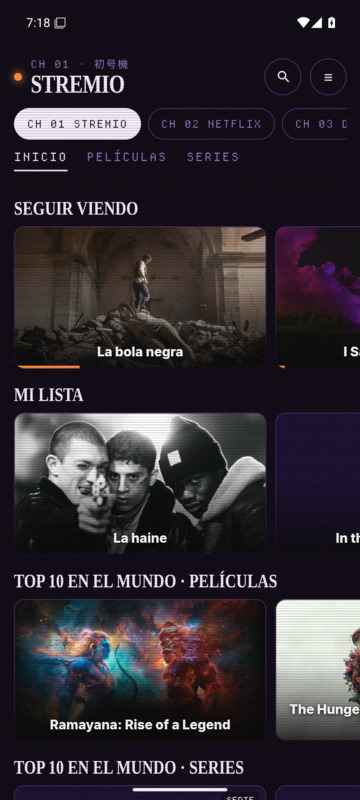
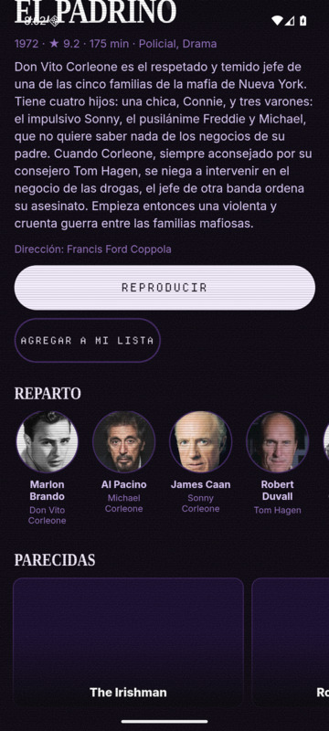
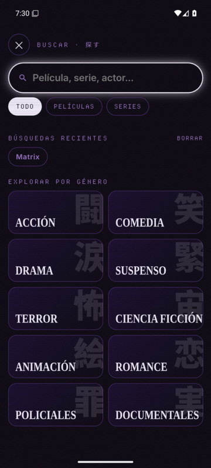
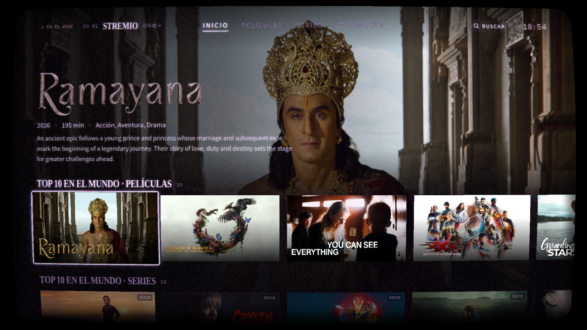

<div align="center">

# SINTONÍA 同調

**Una tele retro para ver películas y series.**
Canales con la estética de un televisor viejo (Stremio, Netflix, Disney+, Max, Prime Video y Crunchyroll),
reproductor propio, subtítulos en español y reseñas en Letterboxd.


</div>

---

## ⬇️ Descargar

Elegí **el archivo de tu sistema**. Son tres archivos distintos: uno para cada sistema, no los mezcles.

| Tu equipo | Archivo que tenés que bajar | Tamaño |
|---|---|---|
| 📱 **Celular Android** | [**SINTONIA-Android.apk**](https://github.com/swamidri-cyber/sintonia/releases/latest/download/SINTONIA-Android.apk) | 43 MB |
| 🪟 **Computadora con Windows** (10 u 11) | [**SINTONIA-Windows-Instalador.exe**](https://github.com/swamidri-cyber/sintonia/releases/latest/download/SINTONIA-Windows-Instalador.exe) | 200 MB |
| 🐧 **Computadora con Linux** | [**SINTONIA-Linux.AppImage**](https://github.com/swamidri-cyber/sintonia/releases/latest/download/SINTONIA-Linux.AppImage) | 310 MB |

> **¿iPhone o Mac?** Por ahora no hay versión.
>
> **¿No sabés si tu compu es Windows o Linux?** Si al prenderla aparece el botón de inicio de Windows (el logo de cuatro cuadrados), es Windows.

Todas las versiones anteriores están en [**Versiones**](https://github.com/swamidri-cyber/sintonia/releases).

---

## 📱 Instalar en Android

1. Desde el celular, tocá el enlace **[SINTONIA-Android.apk](https://github.com/swamidri-cyber/sintonia/releases/latest/download/SINTONIA-Android.apk)**. Se descarga el archivo.
2. Abrí la descarga (desde la notificación o desde la app **Archivos → Descargas**).
3. La primera vez, Android avisa que no deja instalar apps desde esa aplicación.
   Tocá **Configuración**, activá **Permitir de esta fuente** y volvé atrás.
4. Tocá **Instalar**.
   Si aparece *Play Protect* diciendo que la app es desconocida, tocá **Más detalles → Instalar de todas formas**.
   (Aparece porque la app no está en Google Play, no porque tenga algo raro.)
5. Abrí **SINTONÍA** desde el menú de apps.

**Para actualizar:** bajá el `.apk` nuevo y repetí los pasos. Se instala encima y no perdés nada.

<p>



</p>

**En el celular podés:**
- Ver en el teléfono: la película se baja mientras la mirás, no hace falta la compu.
- Mandarla a la tele con **Chromecast**. Mientras se ve en la tele queda un aviso fijo de SINTONÍA, así que podés bloquear el celular o usar otras apps sin que se corte.
- Correr los subtítulos si no coinciden con la voz (botón **SINCRONIZAR** durante la película).

---

## 🪟 Instalar en Windows

1. Bajá **[SINTONIA-Windows-Instalador.exe](https://github.com/swamidri-cyber/sintonia/releases/latest/download/SINTONIA-Windows-Instalador.exe)**.
2. Abrilo con doble clic.
3. Windows puede mostrar una pantalla azul que dice **«Windows protegió su PC»**.
   Tocá **Más información** y después **Ejecutar de todas formas**.
   (Aparece con cualquier programa que no esté firmado por una empresa.)
4. Seguí el instalador: **Siguiente → Instalar → Finalizar** (si querés el ícono en el escritorio, marcá esa casilla). No pide permisos de administrador.
5. Abrí **Sintonía** desde el menú Inicio.

**Para desinstalar:** Configuración → Aplicaciones → Sintonía → Desinstalar.

---

## 🐧 Instalar en Linux

La versión de Linux es un **AppImage**: un único archivo que se abre sin instalar nada.

**Forma fácil (con el mouse):**
1. Bajá **[SINTONIA-Linux.AppImage](https://github.com/swamidri-cyber/sintonia/releases/latest/download/SINTONIA-Linux.AppImage)**.
2. Clic derecho sobre el archivo → **Propiedades → Permisos** → activá **Permitir ejecutar como programa** (o «Es ejecutable»).
3. Doble clic para abrirla.

**Forma rápida (en una terminal),** que además la agrega al menú de aplicaciones:

```bash
curl -L -o /tmp/SINTONIA-Linux.AppImage https://github.com/swamidri-cyber/sintonia/releases/latest/download/SINTONIA-Linux.AppImage
curl -sL https://raw.githubusercontent.com/swamidri-cyber/sintonia/main/empaque/instalar-linux.sh | bash -s /tmp/SINTONIA-Linux.AppImage
```

> Si al abrirla dice algo de **FUSE**, abrila así: `./SINTONIA-Linux.AppImage --appimage-extract-and-run`
> (o instalá el paquete `fuse2` / `libfuse2` de tu distribución).



---

## ▶️ La primera vez que la abrís

1. Conectá tu cuenta de **Stremio** (mail y contraseña) en la configuración:
   - **En el celular:** botón **≡** arriba a la derecha → **CONFIGURACIÓN**.
   - **En la compu:** la primera vez se abre sola; después, con la tecla **,** (coma) o el botón **≡** del joystick.
   Con tu cuenta vienen tus *addons*, que son las fuentes para ver. **Sin cuenta solo se ven los catálogos.**
   Si no tenés cuenta, creala gratis en [stremio.com](https://www.stremio.com) y agregá ahí los addons que uses.
2. Opcional: conectá **Letterboxd**. Al terminar una película, SINTONÍA te ofrece dejar la reseña, y siempre te pregunta antes de publicar.
3. Elegí un canal, una película y **Reproducir**. Te pregunta el idioma y si querés subtítulos en español.

---

## ❓ Preguntas

**¿Es gratis?** Sí.

**¿Tiene Netflix o Disney+ de verdad?** No. Los canales con esos nombres muestran *qué hay* en cada plataforma, y se ve con las fuentes de tus addons de Stremio. SINTONÍA no guarda ni ofrece películas: hace lo mismo que la app de Stremio, con otra cara.

**¿Mis datos?** Tu cuenta de Stremio y tu sesión de Letterboxd quedan solo en tu equipo.

**Encontré un problema.** Contalo en [Issues](https://github.com/swamidri-cyber/sintonia/issues).

---

<sub>Para desarrolladores: cómo está hecha y cómo se compila en [DESARROLLO.md](DESARROLLO.md).</sub>
